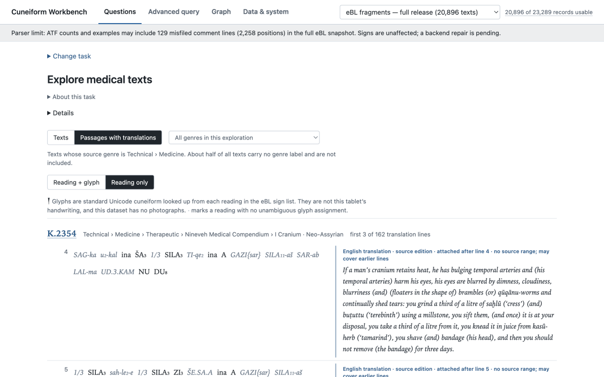
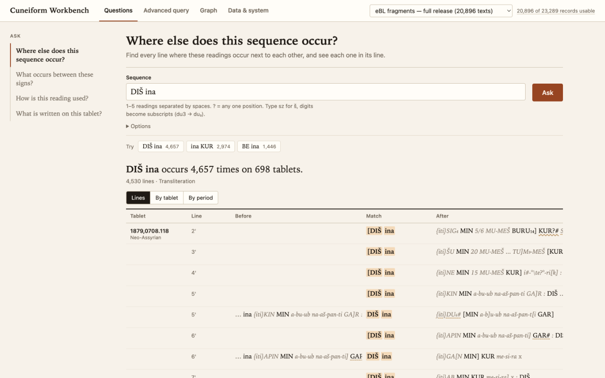
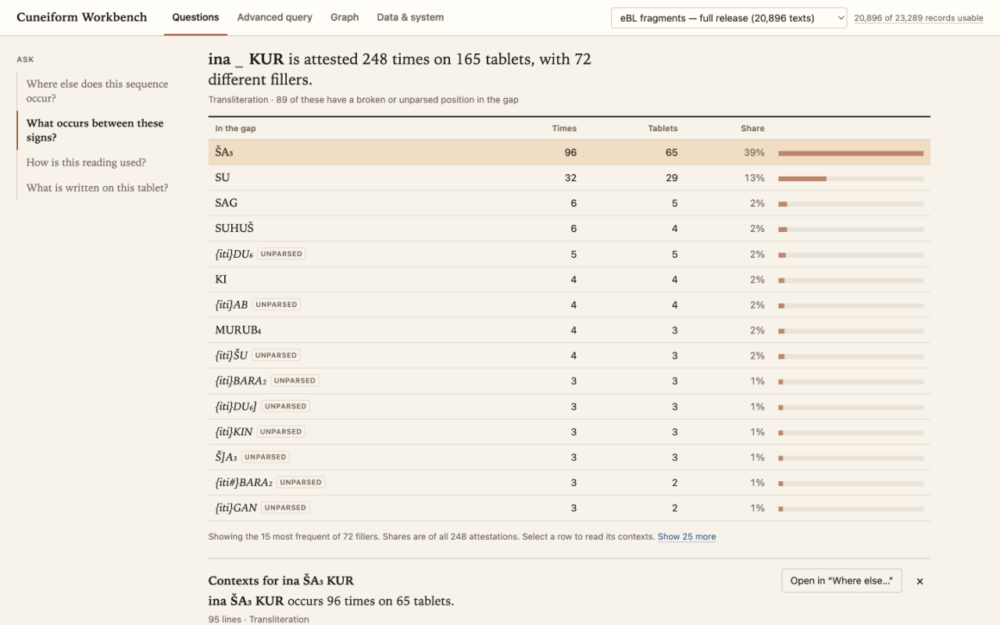
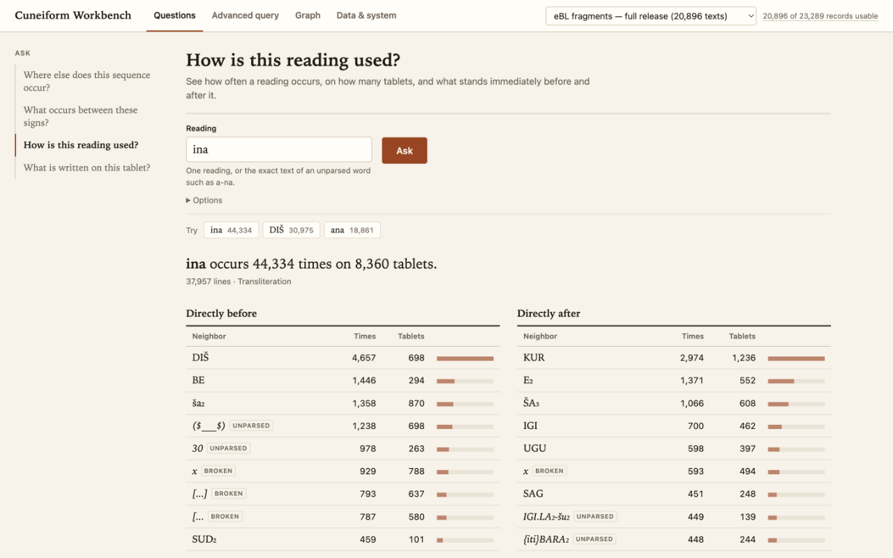
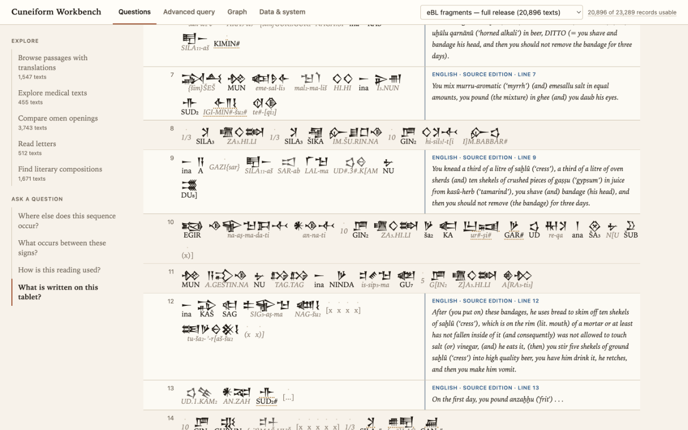
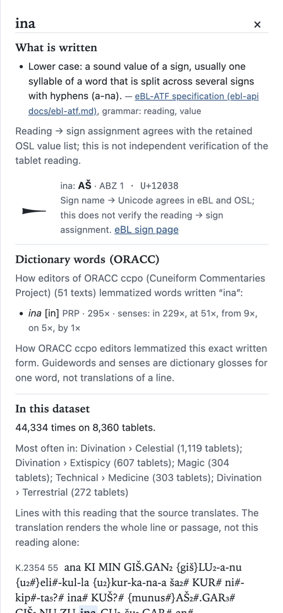
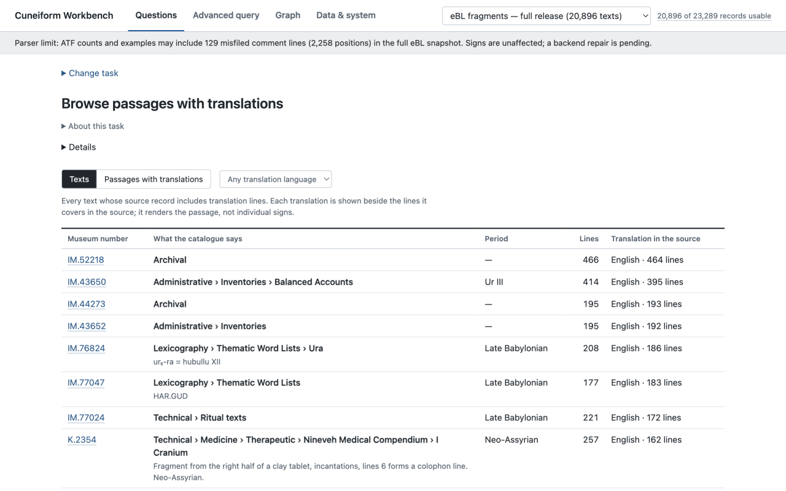
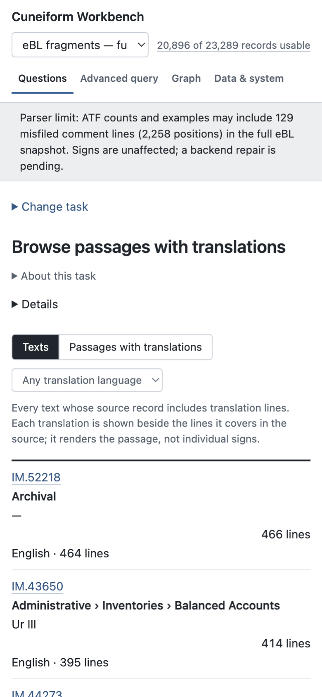

# Cuneiform Workbench

Browse edited cuneiform texts, follow their sources, and ask reproducible questions about represented sign sequences. This repository includes the local web interface, Python/DuckDB backend, and benchmark code and results.

## See it in use

These are actual full-corpus captures from 5 November 2026. The quickstart uses synthetic data; the development corpus has since been removed. White/grey captures show the final simplified design. Brown captures show the earlier design, with the same question workflows.

### Read passages beside their translation

Compare edited readings with the source translation. A translation can cover several lines; this is not word-by-word alignment.



### Find a sequence in context

Search a sequence, see its surrounding readings, and group results by tablet or catalogue period. Earlier design.



### See what occurs between signs

Compare attested fillers and open their contexts. This retrieves examples; it does not predict missing text. Earlier design.



<details>
<summary><strong>How is this reading used? — neighbouring readings</strong></summary>

Compare the positions immediately before and after a reading. Earlier design.



</details>

<details>
<summary><strong>Read a tablet — glyphs, transliteration and translation</strong></summary>

Standardized glyphs are not tablet photographs. This earlier capture predates corrected translation-attachment labels: “LINE 7” does not establish an exact translation range.



</details>

<details>
<summary><strong>Explain a reading — mobile inspector</strong></summary>

Inspect the written form, sign mapping and dictionary senses. Final simplified design.



</details>

<details>
<summary><strong>Browse texts — desktop and mobile</strong></summary>





</details>

Source passages and editorial translations are from eBL; dictionary aids use ORACC. Source rights remain separate from the UI. See [capture provenance and caveats](docs/GALLERY.md#capture-provenance).

## Install and run

Requires Python **3.11+**, Git, Bash and a browser. No Docker, API key, corpus download or Node build is needed.

```sh
git clone https://github.com/danieliser/cuneiform-workbench.git
cd cuneiform-workbench
python3 -m venv .venv
.venv/bin/python -m pip install -r requirements.txt
bin/demo start
# Open http://127.0.0.1:8741/
bin/demo stop
```

The demo uses tiny **synthetic fixtures**, including synthetic translations. Choose **Change task → Where else does this sequence occur?** Enter `A B C`: expect **6 matches**. Enter `A ? C`: expect **11**. Strict evidence policy returns zero because the parser does not infer certainty.

The launcher exports backend commit `057a0b757ed3dc05e486893bc344a15dd73c86d8` from this repository's complete history into `~/.local/share/cuneiform-ui-demo`. Use a normal clone: shallow clones and GitHub ZIP downloads may lack that commit. Override `CUNEIFORM_DEMO_HOME`, `CUNEIFORM_UI_PORT` or `CUNEIFORM_PY` as needed. No sibling checkout is used. The demo does not read the canonical corpus store.

## Read and ask

Four questions are implemented:

- **Where else does this sequence occur?** Exact or wildcard windows with surrounding readings.
- **What occurs between these signs?** Group represented intervening positions and inspect examples.
- **How is this reading used?** Occurrences, catalogue groupings and source examples.
- **What is written on this tablet?** Edited lines and available source translations.

With a separately supplied eligible snapshot, browse passages and select readings for source notes and occurrence examples. URLs retain the task and inputs. This is a starting point for Assyriologists checking contexts, students learning transliteration, and computational researchers inspecting data before an experiment. Scholarly usefulness has not been established by a researcher study.

Transliteration is an editor's reading, with uncertainty and restoration marks. Unicode glyphs are standardized characters, not tablet photographs. Source translations may cover multiple lines; attachment to a line does not establish an exact range or word alignment. Dictionary glosses are separate aids. Missing or ambiguous sign assignments stay visible.

## Repository layout

| Path | Contents |
| --- | --- |
| `server/`, `web/`, `bin/` | Local UI, HTTP API and launchers |
| `backend/` | Python package, fixtures, source terms, model specs and backend tests |
| `benchmarks/` | Executable protocols, frozen configs, historical runs and reviews |
| `docs/` | [Gallery](docs/GALLERY.md), [operations](docs/OPERATIONS.md), [future experiments](docs/FUTURE-EXPERIMENTS.md), [consolidation and historical paths](docs/CONSOLIDATION.md) |
| `reviews/`, `CHECKPOINT.md` | Earlier UI reviews and engineering record |

## What the benchmarks found

The [benchmark results](benchmarks/RESULTS.md) separate query correctness and speed from research value. The final [value audit](benchmarks/VALUE-VERDICT.md) returned **NO-GO for measured construction advantage**: the tested construction did not show a practical advantage over standard retrieval methods or a small raw-source script. Metadata helped completion too little, selected evidence tasks did not save effort, and a genre relation feature reduced retrieval performance. The remaining completion claim was inconclusive overall.

That verdict concerns the tested research construction; it does not establish that nobody can use the app. These are historical measurements, not results reproduced by installing the demo. The corpus and development environment were removed when the experiment closed. See [benchmark reproduction](benchmarks/README.md) for supplying your own eligible inputs and [research outcome](docs/RESEARCH-OUTCOME.md) for the claim boundary.

[Future experiments](docs/FUTURE-EXPERIMENTS.md) describe individual signs, sign groups, words and phrases as interpretation overlays, reversible propagation through contexts, and agent-assisted hypothesis review. These are proposals. No novel decipherment, restoration accuracy or validated interpretation is claimed.

## Data, rights and limits

No corpus payloads, downloads, credentials, model weights or runtime stores are bundled. The screenshots show historical full-corpus sessions, not the synthetic quickstart. The historical eligible eBL snapshot covered 20,896 of 23,289 records in fixed Zenodo release 10018951, not all eBL, ORACC, CDLI or cuneiform. It contained no tablet photographs.

The demo pin uses `conservative-3`; in the historical full snapshot that parser misfiled 129 comment/translation lines (2,258 positions) as text in 49 records. ATF counts can include them; the signs layer was clean. A later `conservative-4` rebuild was not independently accepted at closure. No corpus verification is implied by this packaging change. The [parser record](backend/docs/PARSER-REVISIONS.md) gives details.

Review [source terms](backend/docs/SOURCE-AUDIT.md) before obtaining data: the eBL license conflict remains unresolved. Source snippets and reference facts retain their attribution; public benchmark publication is not a new source-data rights grant. The bundled Noto font has its own [OFL](web/fonts/OFL.txt); OSL reference facts record CC0 provenance in `server/refdata/sign-map.json`. **No root software license has been selected**; public visibility alone does not grant an open-source license.

The UI binds to loopback and is experimental local software, not a maintained hosted multi-user service. Real-data ingestion is a separate opt-in workflow: [ingestion design](backend/docs/INGESTION-DESIGN.md), [publication protocol](backend/docs/PUBLICATION-PROTOCOL.md), and [operations](docs/OPERATIONS.md).

## Development and tests

```sh
# From the repository root, after installing requirements.txt:
bin/test
```

Tests use synthetic fixtures; absent retained samples, optional FalkorDB and opt-in disk/corpus checks skip with reasons. These skips are not full-corpus evidence. Disk tests require explicit storage admission; do not enable them against an existing corpus casually. The current backend lives under `backend/`; the demo stays pinned for compatibility. The original atlas and queues are historical references, as explained in [consolidation](docs/CONSOLIDATION.md).
