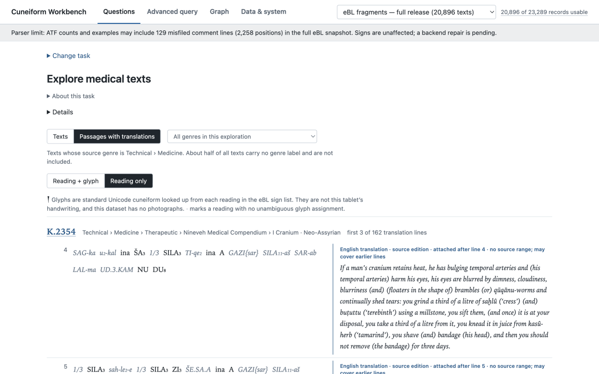
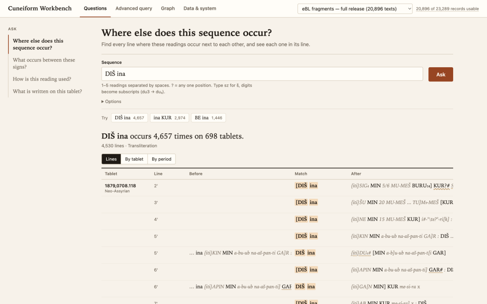
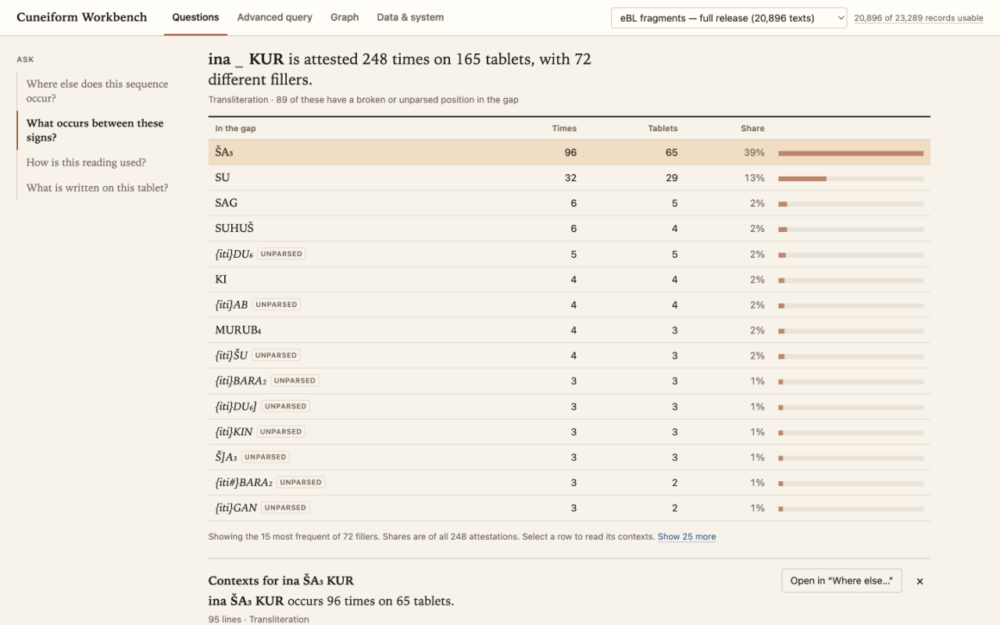
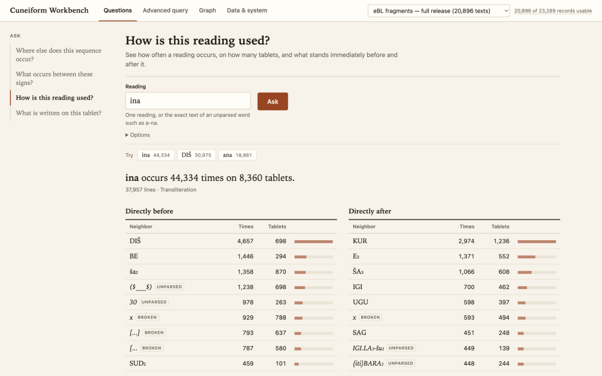
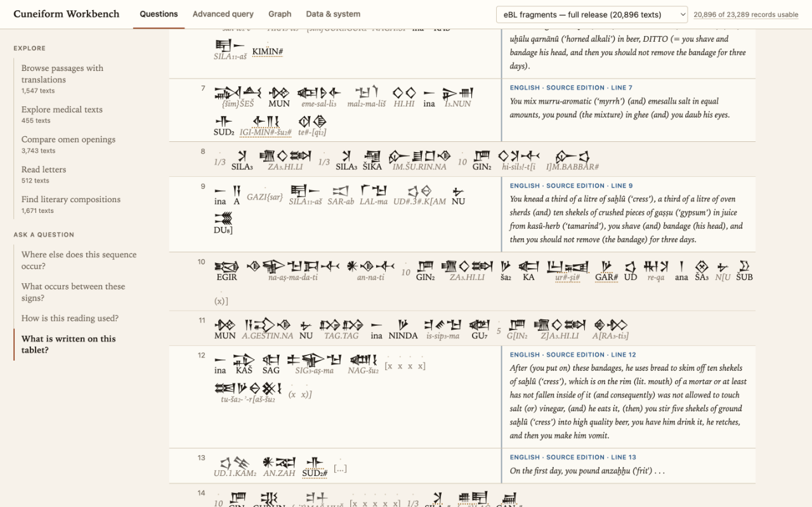
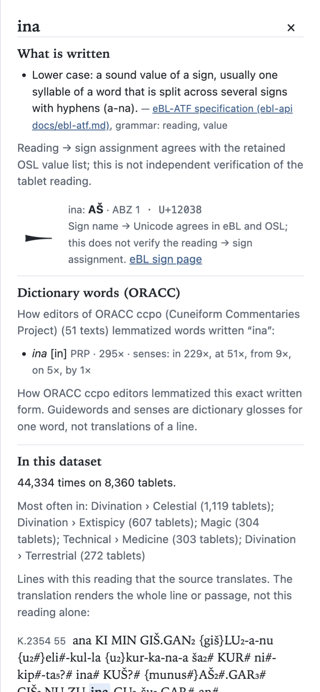

# Workflow gallery

Actual screenshots retained from local full-corpus sessions on 5 November 2026. These are historical captures, not a currently hosted corpus. The quickstart uses synthetic fixtures. The original eBL release contained 20,896 eligible texts; its parser limitations are described in the README.

## Read passages beside their source translation

Final simplified design (`2a43151`). The translation is attached to a source position and may cover earlier lines; it is not a word-by-word alignment. Source: eBL tablet [K.2354](https://www.ebl.lmu.de/fragmentarium/K.2354). Source translations and editorial data retain their original rights.

## Find a sequence in its surrounding lines

Earlier question-led design (`19c86b0`), before the white/grey redesign. The highlighted match stays beside its preceding and following readings. Results can be grouped by tablet or catalogue period.

## Compare what occurs between signs

Earlier design (`19c86b0`). Group attested fillers, inspect their frequencies, then select one to open its contexts. This retrieves represented passages; it does not predict missing text.

## Inspect a reading's neighbours

Earlier design (`19c86b0`). Compare immediate preceding and following positions. These are corpus counts, not inferred meanings.

## Read glyphs, transliteration and translation together

Earlier reading-aids design (`6354880`). This capture predates corrections to translation attachment labels and glyph-verification wording: a label such as “LINE 7” does not establish exact translation alignment. Glyphs are standardized Unicode forms, not handwriting or images of the tablet. Ambiguous reading assignments require care. Source: eBL [K.2354](https://www.ebl.lmu.de/fragmentarium/K.2354).

## Open a reading explanation

Final simplified design (`2a43151`), mobile. The inspector distinguishes the written form, sign mapping and ORACC dictionary senses. It can send a reading back into the occurrence questions.

## Capture provenance

Recovered unchanged from the private verified development archive. Question captures originated in `output/q-ui-redesign`, the glyph/tablet capture in `output/q025/after`, and final-design captures in `output/simplify`. No screenshot was recoloured or reconstructed to imply that an earlier screen used the final design. UI source data derives from eBL and ORACC; screenshots do not grant a separate licence to that data. See [reading-aid sources](../backend/docs/READING-AIDS-SOURCES.md).
